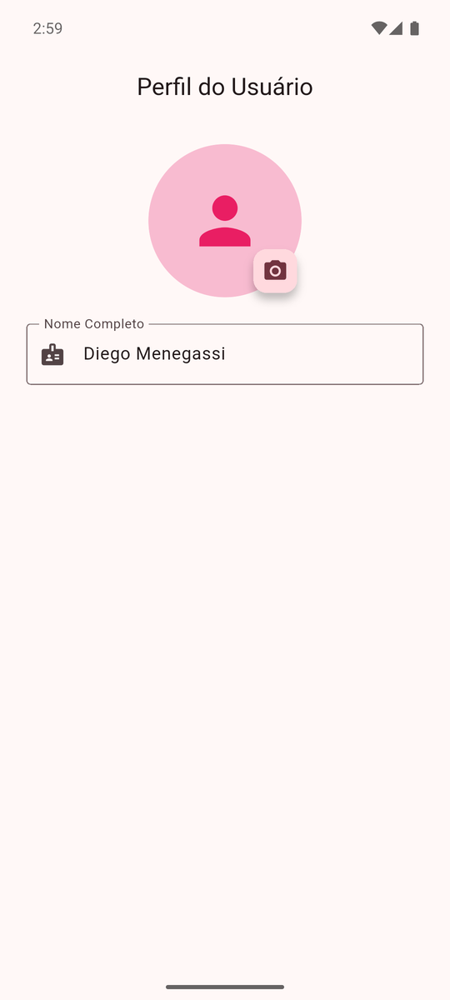
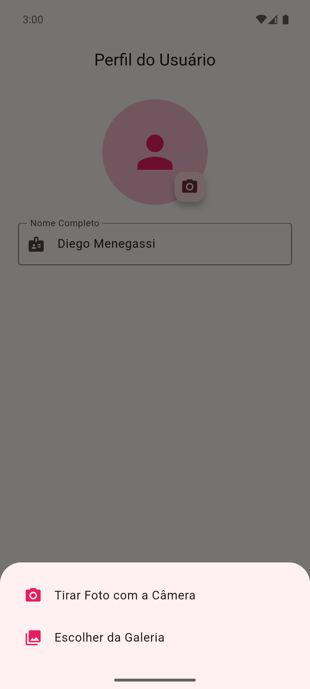
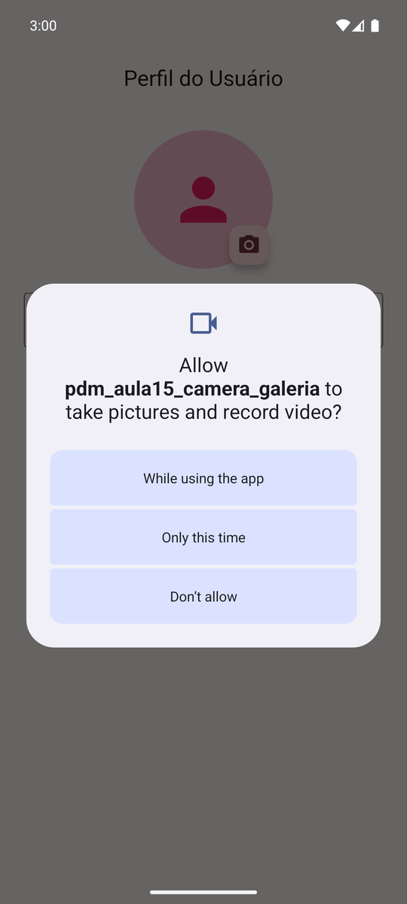
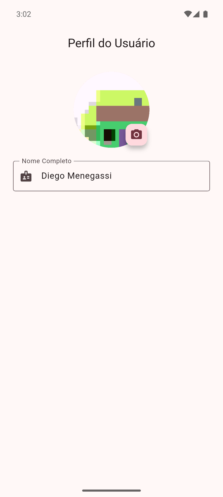
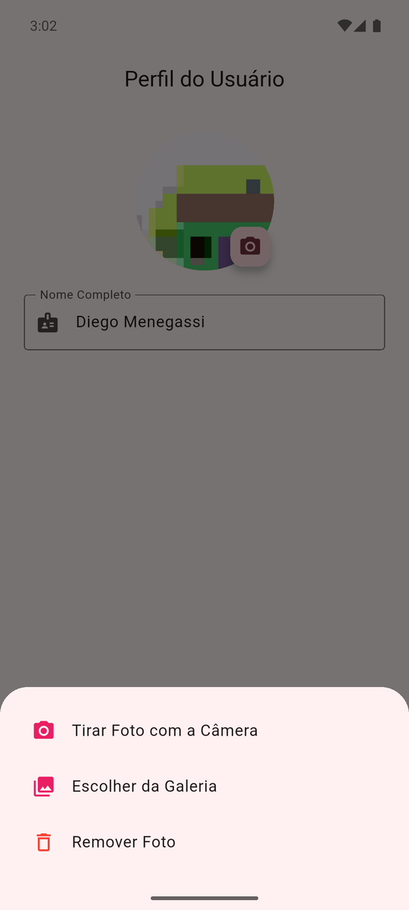
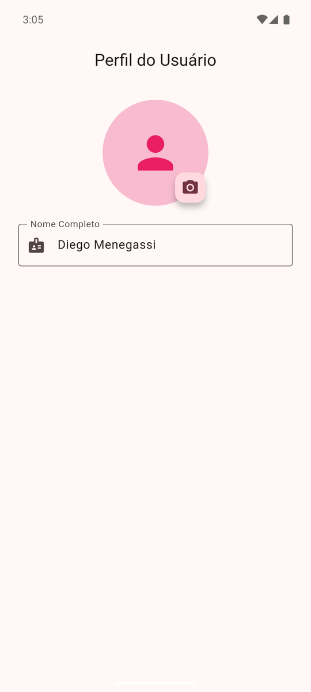
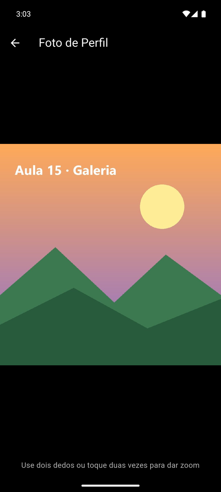
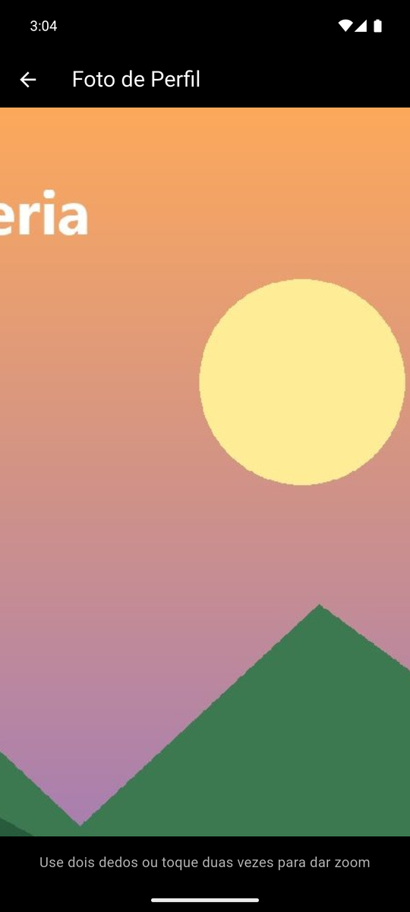
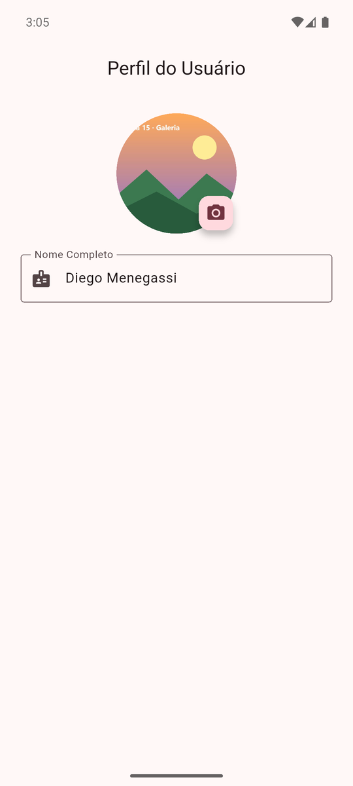

# PDM Aula 15 — Câmera e Galeria de Mídia

Roteiro prático da disciplina **Programação para Dispositivos Móveis I** (Semestre 2026/2) —
Aula 15: *Captura de Fotos e Manipulação de Imagens no Flutter*.

Tela de **Perfil do Usuário** com foto. O botão de câmera sobre o avatar abre um
`ModalBottomSheet` com as duas origens: a câmera nativa e a galeria, pelo pacote oficial
[`image_picker`](https://pub.dev/packages/image_picker). A foto escolhida vira um `File`
(`dart:io`) e aparece no `CircleAvatar`. Sem foto, o avatar mostra o ícone padrão.

## Arquitetura

| Diretório / Arquivo | Responsabilidade | Conceitos aplicados |
|---|---|---|
| `lib/services/media_service.dart` | Único ponto de acesso ao `ImagePicker`: câmera, galeria, suporte da plataforma e foto perdida | `pickImage` com `ImageSource.camera`/`gallery`, `imageQuality: 85`, `maxWidth: 1080`, `XFile` → `File`, `supportsImageSource`, `retrieveLostData` |
| `lib/services/foto_perfil_storage.dart` | Guarda a foto entre execuções | `path_provider` (pasta de documentos), `File.copy`, `SharedPreferences` |
| `lib/screens/perfil_screen.dart` | Avatar, `ModalBottomSheet`, nome e avisos | `CircleAvatar` com `FileImage`, `Stack` + `Positioned`, `FloatingActionButton.small`, `Hero`, `SnackBar` |
| `lib/screens/foto_tela_cheia_screen.dart` | Foto em tela cheia com zoom | `Image.file`, `InteractiveViewer`, `TransformationController`, toque duplo |
| `lib/main.dart` | `MaterialApp` com Material 3 | `ThemeData(colorSchemeSeed:)` |

```
lib/
├── main.dart
├── screens/
│   ├── foto_tela_cheia_screen.dart
│   └── perfil_screen.dart
└── services/
    ├── foto_perfil_storage.dart
    └── media_service.dart
```

### Permissões declaradas

| Plataforma | Arquivo | Declaração |
|---|---|---|
| Android | `android/app/src/main/AndroidManifest.xml` | `CAMERA`; `READ_EXTERNAL_STORAGE` só até o Android 12 (`maxSdkVersion="32"`); `<uses-feature android.hardware.camera required="false">` |
| iOS | `ios/Runner/Info.plist` | `NSCameraUsageDescription` e `NSPhotoLibraryUsageDescription` com os textos do diálogo do sistema |

A partir do Android 13 a galeria abre pelo **Photo Picker** do sistema. O app recebe só a foto
escolhida e não precisa de permissão de leitura, por isso `READ_EXTERNAL_STORAGE` vale até a API
32. A câmera abre o app de câmera do aparelho (`ACTION_IMAGE_CAPTURE`). Como `CAMERA` está no
manifesto, o `image_picker` pede essa permissão antes (print 03).

### Fluxo da foto

1. O botão de câmera chama `_exibirOpcoesMidia()`, que abre o `showModalBottomSheet`.
2. **Tirar Foto com a Câmera** ou **Escolher da Galeria** fecha o menu e chama o `MediaService`.
   O `pickImage` devolve um `XFile`, ou `null` se o usuário cancelar, e o serviço converte em `File`.
3. A foto é copiada para a pasta do app (Desafio Avançado) e o `setState` troca o
   `backgroundImage` do `CircleAvatar` por um `FileImage`. O ícone padrão sai.

## Desafios de laboratório implementados

O roteiro pede ao menos um. Os três foram resolvidos:

| Nível | Desafio | Implementação |
|---|---|---|
| **Básico** | Remoção e Reset de Foto | Opção **Remover Foto** no `ModalBottomSheet`. Ela só aparece quando há foto. Faz `setState(() => _imagemPerfil = null)`, o avatar volta ao ícone padrão e um `SnackBar` confirma. A altura fixa de 160 do roteiro não comportava a terceira opção; a coluna passou a usar `mainAxisSize.min` |
| **Intermediário** | Visualização em Tela Cheia | Tocar na foto abre `FotoTelaCheiaScreen`. O avatar e a imagem compartilham a tag `foto-perfil`, então o `Hero` anima a foto saindo do círculo até ocupar a tela. O `Image.file` fica num `InteractiveViewer` (zoom de 1× a 5× com dois dedos). O toque duplo amplia 2,5× no ponto tocado e o seguinte volta ao normal. Sem foto, o avatar não abre nada |
| **Avançado** | Persistência do Caminho no SharedPreferences | `FotoPerfilStorage` grava o caminho da foto na chave `key_foto_perfil_path`. No `initState` o caminho é lido e, se o arquivo existir, a foto volta ao avatar. Se o arquivo sumiu, a chave é limpa e fica o avatar padrão. **Remover Foto** apaga a chave e o arquivo |

**Por que copiar a foto antes de gravar o caminho.** O `image_picker` devolve a foto na pasta de
**cache** do app (`cache/scaled_*.jpg`). A documentação do pacote avisa que esses arquivos são
temporários, e o sistema pode limpar o cache quando quiser. Gravar esse caminho funcionaria até a
primeira limpeza. Por isso a foto é copiada para a pasta de documentos do app (`path_provider`), e
o caminho gravado é o da cópia. Cada foto nova ganha um nome com a hora (`foto_perfil_<ms>.jpg`)
e a cópia anterior é apagada. O nome muda porque o `FileImage` guarda as imagens em cache pelo
caminho: sobrescrever o mesmo arquivo mostraria a foto antiga.

Estado no emulador depois de escolher uma foto da galeria (lido com `adb shell run-as`):

```
cache/scaled_1000000025.jpg                   ← devolvida pelo image_picker (temporária)
app_flutter/foto_perfil_1794841382461.jpg     ← cópia permanente
shared_prefs/FlutterSharedPreferences.xml:
  <string name="flutter.key_foto_perfil_path">/data/user/0/br.fatec.pdm.pdm_aula15_camera_galeria/app_flutter/foto_perfil_1794841382461.jpg</string>
```

Depois de **Remover Foto**, `app_flutter/` ficou sem nenhuma `foto_perfil_*` e o XML ficou vazio
(`<map />`).

## Evidências

Capturas do app rodando no **emulador Android** (Pixel 7, API 35). A foto da câmera vem da câmera
virtual do emulador (a cena em pixel art). A da galeria é uma imagem de teste gerada para o
trabalho e colocada em `/sdcard/Pictures`. Os diálogos do sistema aparecem em inglês porque é o
idioma padrão do emulador.

| Avatar padrão | Origem da mídia | Permissão da câmera |
|---|---|---|
|  |  |  |
| `CircleAvatar` com o ícone e o nome do roteiro | `ModalBottomSheet` com câmera e galeria | O Android pede `CAMERA` antes de abrir a câmera |

| Permissão negada | Câmera nativa | Foto da câmera |
|---|---|---|
|  |  |  |
| Correção: aviso em português em vez de exceção sem resposta | `ImageSource.camera` abre o app de câmera do aparelho | `FileImage` no `CircleAvatar` |

| Básico — menu com Remover | Galeria | Básico — foto removida |
|---|---|---|
|  |  |  |
| Com foto, aparece a terceira opção | Foto escolhida pelo Photo Picker | Avatar padrão de volta e `SnackBar` |

| Intermediário — tela cheia | Intermediário — zoom | Avançado — app reaberto |
|---|---|---|
|  |  |  |
| `Hero` + `Image.file` no `InteractiveViewer` | Toque duplo: 2,5× em volta do sol | `am force-stop` e nova abertura: a foto volta pelo `SharedPreferences` |

**Correção — foto perdida pelo Android.** Com a câmera aberta, o processo do app foi encerrado
(`adb shell am kill`, o que o Android faz quando falta memória). Depois de **Done** na câmera, o
Android recriou o app num processo novo (pid 15178 → 15715). O `Future` do `pickImage` tinha
morrido junto com o processo antigo. A foto chegou pelo `retrieveLostData()` na abertura, foi
copiada e gravada. No código do roteiro, ela se perderia.

| Foto recuperada após o processo morrer |
|---|
|  |

## Como executar

```bash
flutter pub get
flutter emulators --launch Pixel_7_API_35   # ou um celular Android com depuração USB
flutter run
```

O projeto foi feito para **Android e iOS**, que é o que o roteiro pede com `File` (`dart:io`) e
`Image.file`. Só o Android foi executado. Pela implementação dos plugins, no **Windows** a galeria
abre o seletor de arquivos e a opção de câmera some do menu, porque o `image_picker` não tem câmera
no desktop sem um `cameraDelegate`. Rodar no Windows exige o Modo de Desenvolvedor, que não estava
ativo aqui. No **navegador** não há `File` do `dart:io` nem pasta de documentos (`path_provider`),
então a foto não é exibida. A falha cai no tratamento de erro e vira o aviso do app.

## Testes

São 26 testes. A câmera e a galeria são simuladas: os testes trocam `ImagePickerPlatform.instance`
por um `FakeImagePicker`, que devolve um `XFile` apontando para um PNG real numa pasta temporária.
O `path_provider` aponta para essa pasta (`PathProviderPlatform.instance`) e o `SharedPreferences`
usa `setMockInitialValues`. Assim a cópia, a gravação do caminho, a leitura na reabertura e a
remoção acontecem de fato no disco. Como E/S real não anda no relógio falso do `testWidgets`, o
helper `_aguardarDisco` alterna `tester.runAsync` e `pump`.

| Grupo | O que é verificado |
|---|---|
| `MediaService` | Origem, `imageQuality: 85` e `maxWidth: 1080` da câmera e da galeria, cancelamento (`null`), `cameraDisponivel`, `recuperarFotoPerdida` e tradução dos erros |
| `FotoPerfilStorage` | Cópia para a pasta de documentos com o caminho gravado, limpeza da cópia anterior, arquivo sumido limpando a chave e remoção |
| Tela do roteiro | Avatar padrão e nome, menu com as duas origens, foto da galeria e da câmera no `CircleAvatar` e cancelamento |
| Desafio Básico | **Remover Foto** só com foto, avatar padrão de volta e `SnackBar` |
| Desafio Intermediário | Avatar sem foto não navega, tags do `Hero` nas duas telas, `InteractiveViewer` com 1×–5×, `Image.file` com o mesmo arquivo, toque duplo 2,5× e volta |
| Desafio Avançado | Caminho gravado aponta para a cópia, foto restaurada ao reabrir, arquivo sumido e remoção apagando chave e arquivo |
| Correções | Permissão negada vira aviso, câmera escondida sem suporte, foto perdida recuperada e `setState` depois do `dispose` |

```bash
flutter test
```

```
00:10 +26: All tests passed!
```

Os quatro testes do grupo **Correções** também rodaram contra o código antes da correção (commit
do Desafio Avançado) e **falharam lá**: `PlatformException(camera_access_denied)` sem tratamento,
câmera oferecida sem suporte, foto perdida ignorada e `setState() called after dispose()`.

## Ajustes em relação ao código do roteiro

- **`Colors.rose` não existe** no Flutter (erro de compilação no tema, nos ícones e no fundo do
  avatar). Foi trocado por `Colors.pink`, o tom rosa equivalente.
- **Versão do pacote:** o roteiro indica `image_picker: ^1.1.0`; o `flutter pub add` gravou
  `^1.2.4`, versão atual dentro da mesma faixa.
- **Manifesto:** o bloco do roteiro só tem comentários. Foram declaradas as permissões que ele
  descreve (câmera e leitura do armazenamento), com o limite de versão explicado acima.
- **Plataformas Android e iOS:** o molde dos trabalhos cria só web e Windows, mas o roteiro pede o
  `AndroidManifest.xml` e o `Info.plist`. O projeto foi criado com
  `--platforms web,windows,android,ios`.
- **Erros da câmera e da galeria:** permissão negada, aparelho sem câmera ou falha ao copiar o
  arquivo lançavam exceção dentro do `onTap`. Ninguém tratava, e a foto simplesmente não
  aparecia. Agora viram um `SnackBar` em português (`mensagemDeErroMidia`).
- **Câmera sem suporte:** no Windows o `image_picker` lança `StateError` ao pedir a câmera sem um
  `cameraDelegate`. A opção só aparece quando `supportsImageSource(ImageSource.camera)` é
  verdadeiro.
- **Foto perdida no Android:** se o sistema encerra o app enquanto a câmera está aberta, o
  resultado não volta pelo `pickImage`. O `initState` agora chama `retrieveLostData()`, como
  recomenda a documentação do pacote (print 13).
- **Ciclo de vida:** `setState` depois do `await` só roda com a tela montada (`mounted`), e o
  `TextEditingController` do nome é liberado no `dispose`.
- **Limpeza da cópia antiga:** apagar o arquivo anterior é só arrumação, porque a chave já aponta
  para a foto nova. No Windows, apagar falha se a imagem ainda está sendo lida para a tela, e essa
  falha não vira aviso para o usuário.

## Histórico de commits

O versionamento segue o padrão de **commits semânticos** (Conventional Commits). O commit da tela
usa a mensagem dada no roteiro:

```
chore: inicializa projeto Flutter pdm_aula15_camera_galeria
feat: configura image_picker, permissoes de camera e galeria e servico MediaService
feat: implementa captura de foto de perfil com image_picker
feat: adiciona opcao Remover Foto no ModalBottomSheet que restaura o avatar padrao (Desafio Basico)
feat: abre a foto em tela cheia com animacao Hero e zoom pelo InteractiveViewer (Desafio Intermediario)
feat: persiste o caminho da foto no SharedPreferences para manter o perfil apos reiniciar o app (Desafio Avancado)
fix: trata falhas da camera e da galeria, recupera foto perdida no Android e evita setState apos o dispose
test: cobre o MediaService, o armazenamento da foto, a tela do roteiro, os tres desafios e as correcoes
docs: adiciona README com arquitetura e evidencias de execucao
```
